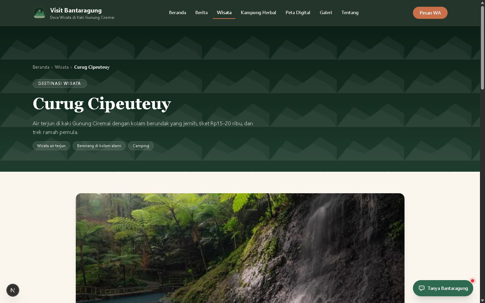
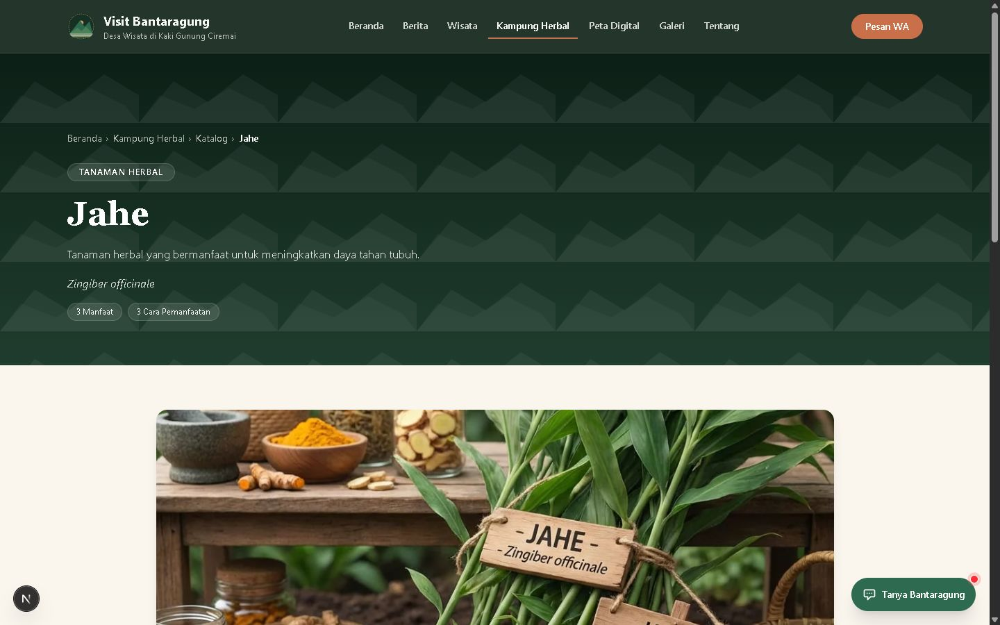
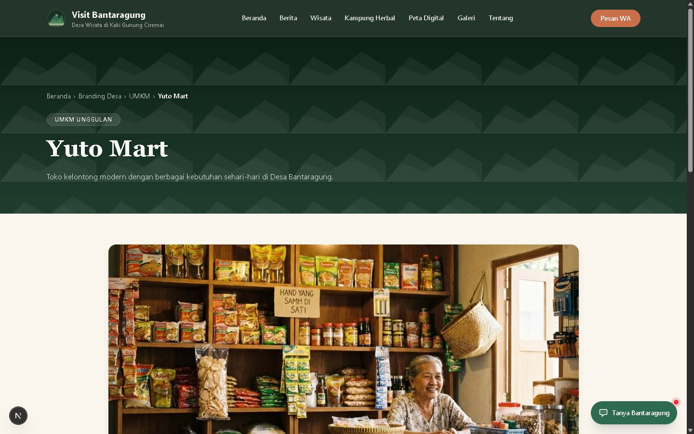
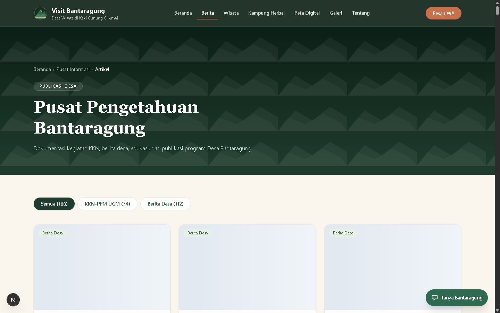
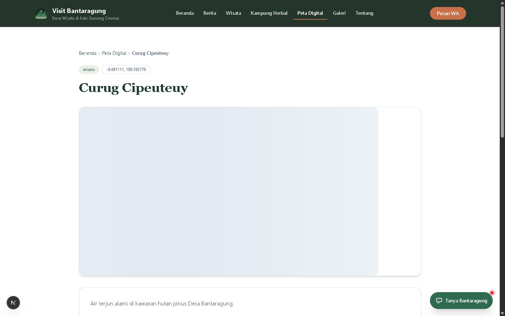

# Visit Bantaragung

Platform digital resmi Desa Wisata Bantaragung, Kecamatan Sindangwangi, Kabupaten Majalengka, Jawa Barat. Repositori ini berisi situs publik, chatbot pemandu, dasbor admin (CMS), dan pipeline sinkronisasi berita otomatis.

Dokumen ini adalah peta cepat proyek: fitur, halaman, arsitektur, cara menjalankan, environment variable, dan dokumentasi lanjutan.

## Status singkat

| Bagian | Ringkasan |
|---|---|
| Situs publik | Next.js App Router, konten JSON, SEO lengkap, responsif |
| Chatbot | "Bantaragung Guide" di kanan bawah, retrieval dari konten, fallback tanpa LLM |
| CMS | Dasbor `/admin`, berbasis Git, tanpa database |
| Sync berita | GitHub Actions, crawl sumber resmi, rewrite AI, deploy otomatis |
| Sumber kebenaran | Folder `content/` di repositori ini |

Tanggal snapshot: 20 Oktober 2026.

---

## 1. Fitur utama

### Situs publik

- Beranda dengan hero, destinasi unggulan, Kampung Herbal, prestasi, berita terbaru, dan ajakan menjelajah.
- Katalog destinasi wisata dengan detail fasilitas, aktivitas, galeri, harga, dan tautan peta.
- Kampung Herbal (B2H) Mertasela: katalog tanaman obat, khasiat, dan cara pemanfaatan.
- Branding Desa (BDB): homestay dan UMKM warga, lengkap dengan kontak WhatsApp.
- Peta Digital (BMC): kategori peta dan detail lokasi.
- Pusat Informasi (BIC): artikel KKN lama dan berita hasil crawl dalam satu alur baca.
- Halaman Tentang, Galeri, Kontak, dan halaman tag.
- SEO: metadata per halaman, canonical, sitemap, robots, feed, news sitemap, dan JSON-LD.
- Aset gambar dapat disajikan dari repositori aset terpisah lewat CDN.

### Chatbot Bantaragung Guide

- Muncul di setiap halaman publik dan menjawab pertanyaan tentang seluruh isi situs.
- Fakta diambil dari indeks `content/`, bukan dari ingatan model.
- Retrieval dua lapis: kartu entitas untuk fakta pasti dan BM25 untuk prosa artikel/berita.
- Jawaban terstruktur untuk daftar destinasi, homestay, UMKM, herbal, paket, harga, dan artikel terbaru.
- Percakapan sosial singkat untuk sapaan, terima kasih, dan penutup.
- Guardrail masukan, pembatasan cakupan, dan filter keluaran.
- Fallback deterministik bila seluruh model gagal, sehingga pengunjung tetap mendapat jawaban dan tautan kontak.

### Dasbor admin (CMS)

- Login dengan kata sandi yang disimpan sebagai hash dan sesi cookie yang aman.
- Ringkasan jumlah konten, status crawler, riwayat commit, dan tombol "Sinkronkan berita".
- Mengelola berita, artikel KKN, wisata, herbal, homestay, UMKM, lokasi peta, dan pengaturan situs.
- Pustaka gambar dengan unggah, kompresi di peramban, salin URL, dan hapus.
- Setiap penyimpanan membuat satu commit ke GitHub, lalu memicu build Vercel.
- Notifikasi hasil sinkronisasi dan status workflow dibaca dari GitHub Actions.

### Sinkronisasi berita otomatis

- Crawl sumber berita resmi desa lewat API, dengan fallback RSS.
- Rewrite AI dengan stage gate yang jujur: model diperiksa lebih dulu, sumber wajib memberi data, dan artikel yang gagal rewrite tidak dipublikasikan mentah.
- Berjalan otomatis secara berkala, dan bisa dipicu manual dari GitHub Actions atau dasbor.
- Tidak ada berita baru berarti sukses, bukan gagal: workflow tetap hijau dan dasbor menampilkan status berhasil.

---

## 2. Halaman publik

| Rute | Isi |
|---|---|
| `/` | Beranda: hero, destinasi unggulan, kampung herbal, prestasi, berita terbaru |
| `/wisata` | Katalog destinasi wisata |
| `/wisata/[slug]` | Detail destinasi: fasilitas, aktivitas, galeri, harga, peta |
| `/b2h` | Kampung Herbal (B2H) / Bantaragung Herbal Hub |
| `/b2h/katalog` | Katalog tanaman herbal |
| `/b2h/katalog/[slug]` | Detail tanaman: khasiat dan cara pemanfaatan |
| `/bdb` | Branding Desa (BDB) / Bantaragung Digital Branding |
| `/bdb/homestay` | Daftar homestay warga |
| `/bdb/homestay/[slug]` | Detail homestay dan kontak |
| `/bdb/umkm` | Daftar UMKM warga |
| `/bdb/umkm/[slug]` | Detail UMKM dan kontak |
| `/bic` | Pusat Informasi (BIC) |
| `/bic/artikel` | Daftar artikel KKN dan berita crawl |
| `/bic/artikel/[slug]` | Detail artikel atau berita |
| `/bmc` | Peta Digital (BMC) / Bantaragung Map Center |
| `/bmc/lokasi/[slug]` | Detail lokasi peta |
| `/galeri` | Dokumentasi kegiatan |
| `/tentang` | Profil desa, sejarah, potensi, prestasi |
| `/kontak` | Kontak resmi, WhatsApp, peta |
| `/tag/[slug]` | Artikel berdasarkan tag |
| `/admin` | Dasbor admin, tidak diindeks mesin pencari |
| `/admin/login` | Halaman masuk admin |

Aset SEO yang disediakan aplikasi: `sitemap.xml`, `robots.txt`, `feed.xml`, dan `news-sitemap.xml`.

## Tangkapan layar

Tampilan halaman-halaman utama (satu representatif per bagian), tanggal snapshot 20 Oktober 2026.

### Halaman publik

| Halaman | Tangkapan |
|---|---|
| Beranda |  |
| Tentang |  |
| Destinasi wisata |  |
| Detail destinasi |  |
| Kampung Herbal |  |
| Detail tanaman herbal |  |
| Branding Desa |  |
| Homestay |  |
| Detail UMKM |  |
| Pusat Informasi |  |
| Artikel |  |
| Peta Digital |  |
| Detail lokasi peta |  |
| Galeri |  |
| Kontak |  |

### Chatbot

Dialog Bantaragung Guide dengan pertanyaan contoh dan jawaban berbasis konten situs:


---

## 3. Chatbot: cara kerja dan kesegaran data

### Alur jawaban

```text
Pertanyaan
  -> guard masukan dan cakupan
  -> deteksi entitas / kebutuhan / pertanyaan terstruktur
  -> retrieval kartu entitas + BM25 artikel dan berita
  -> LLM dengan rantai fallback
  -> filter keluaran
  -> jawaban + sumber + kartu pratinjau
```

Jika LLM tidak bisa dipakai, jawaban tetap disusun dari hasil retrieval. Jika pertanyaan berupa daftar, harga, atau artikel terbaru, jawaban dibuat langsung dari indeks tanpa memanggil LLM.

### Indeks pengetahuan

- Indeks dibangun dari folder `content/` dan disimpan di memori proses.
- Cache indeks disegarkan otomatis setiap 5 menit, sehingga server yang berjalan lama ikut membaca artikel baru.
- Di Vercel, pembaruan utama terjadi saat deployment baru, karena berkas konten ikut dibundel.
- Setiap artikel selalu punya chunk `head` berisi judul dan ringkasan singkat, maksimal 280 karakter. Jadi judul baru tetap dikenali tanpa memasukkan seluruh isi ke konteks model.
- Isi lengkap artikel hanya diindeks bila lolos pemeriksaan gaya dan panjang, lalu diambil saat pertanyaan memang membutuhkan detail.
- Retrieval memberi bonus kesegaran pada tulisan yang lebih baru. Tulisan lama yang relevan tetap bisa muncul sebagai konteks pendukung.
- Pertanyaan seperti "artikel terbaru tentang tradisi" memprioritaskan judul yang relevan dengan topik, diurutkan dari yang terbaru.

### Batas dan fallback

- Pemakaian chatbot dibatasi per hari dan per peramban (IP) agar biaya tetap terkendali; angkanya diatur lewat environment variable di `docs/ADMIN-ENV-VERCEL.md`.
- Rantai model utama dan cadangan juga diatur lewat environment variable, tanpa perlu mengubah kode.
- Penolakan pertanyaan di luar topik dan upaya jailbreak dilakukan sebelum memanggil penyedia model.
- Harga dan fakta sensitif hanya boleh berasal dari konteks yang dikirim ke model.

---

## 4. Dasbor admin (CMS)

```text
Peramban -> /admin (cookie sesi)
         -> /api/admin/* (sesi diverifikasi ulang)
         -> GitHub API (server-side, token rahasia)
         -> situs di-build ulang oleh platform
```

Tangkapan layar halaman CMS (view-only, tanpa perubahan konten):

| Tangkapan CMS |
|---|
|  |
|  |
|  |
|  |
|  |
|  |

### Yang dikelola

| Menu | Isi |
|---|---|
| Ringkasan | Jumlah konten, status crawler, riwayat commit, tombol sinkronisasi |
| Berita | Hasil crawl dari sumber resmi |
| Artikel KKN | Artikel program KKN |
| Destinasi Wisata | Destinasi dan koordinat peta |
| Katalog Herbal | Tanaman obat dan khasiat |
| Homestay | Penginapan warga dan WhatsApp |
| UMKM | Usaha warga dan WhatsApp |
| Lokasi Peta | Titik lokasi peta digital |
| Pustaka Gambar | Unggah, salin URL, hapus gambar |
| Pengaturan Situs | Identitas, kontak, media sosial, SEO |

### Alur menyimpan

1. Buka `/admin` dan masuk.
2. Pilih koleksi, lalu tambah atau ubah entri.
3. Klik Simpan.
4. Satu penyimpanan membuat satu commit dan memicu satu build Vercel.

Catatan penting:

- Gunakan satu penyimpanan per perubahan agar build tidak menumpuk.
- Jika konten berubah sejak halaman dibuka, penyimpanan ditolak untuk mencegah konflik.
- Mengubah slug berarti membuat berkas baru dan menghapus berkas lama.
- Mengganti gambar tidak menghapus gambar lama secara otomatis.
- Gambar baru selalu memakai nama berkas baru karena jsDelivr menyimpan cache permanen per nama.

### Keamanan

- Kata sandi disimpan sebagai hash, sesi memakai cookie yang aman dan diverifikasi ulang di setiap route API admin.
- Path folder memakai allowlist, bukan input mentah.
- Token GitHub memakai izin minimal pada repositori konten dan aset.
- Rahasia disimpan di Vercel dan `.env.local`, tidak pernah di-commit.

---

## 5. Sync berita otomatis

Workflow: `.github/workflows/sync.yml`.

### Pipeline

```text
GitHub Actions (cron atau manual)
  -> GATE 0: pilih model yang sehat (hanya bila ada artikel baru yang perlu rewrite)
  -> crawl sumber berita (REST / RSS)
  -> bersihkan HTML dan filter artikel tipis
  -> rewrite AI
  -> tulis content/bic/berita/*.json dan cover
  -> push otomatis
  -> platform men-build ulang situs (juga bisa lewat deploy hook)
```

### Stage gate

| Gate | Arti |
|---|---|
| GATE 0 | Model harus merespons. Jika tidak ada artikel baru, gate ini tidak dipanggil |
| GATE 1 | Sumber wajib memberi data. Sumber kosong atau offline berarti gagal nyata |
| GATE 2 | Artikel yang gagal rewrite tidak dipublikasikan mentah |
| GATE 3 | Tidak ada artikel baru berarti normal dan sukses, bukan gagal |

### Jadwal dan batas

- Cron terseuche secara berkala (lihat `.github/workflows/sync.yml`), bisa dipicu manual lewat `workflow_dispatch` atau tombol di dasbor.
- Jumlah artikel per run dan batas timeout diatur lewat environment variable workflow.
- Artikel sumber yang terlalu tipis dicatat di `scripts/sync/skip.json` dan dilewati permanen.

### Model crawler

Model utama dan fallback diatur lewat environment variable (lihat `docs/ADMIN-ENV-VERCEL.md`). GATE 0 mencoba kandidat secara berurutan agar satu model yang bermasalah tidak memerahkan seluruh run.

---

## 6. Arsitektur dan struktur folder

```text
Peramban
  -> Next.js App Router di Vercel
       -> halaman publik dari content/
       -> /api/chat -> guard -> retrieval -> LLM -> filter
       -> /admin -> /api/admin/* -> GitHub API -> commit -> Vercel build

GitHub Actions
  -> situs berita sumber
  -> scripts/sync/crawl.js
  -> content/bic/berita + public/berita
  -> commit ke main
  -> Vercel build
```

```text
.
├─ app/                     # Halaman publik, admin, dan API routes
│  ├─ (public pages)        # wisata, b2h, bdb, bic, bmc, galeri, tentang, kontak
│  ├─ admin/                # Login dan dasbor CMS
│  └─ api/                  # chat, visitors, admin
├─ content/                # Sumber kebenaran konten (JSON)
│  ├─ settings/            # site, seo, profile, wisata-pricing
│  ├─ wisata/              # Destinasi wisata
│  ├─ b2h/katalog-tanaman/ # Tanaman herbal
│  ├─ bdb/homestay/        # Homestay
│  ├─ bdb/umkm/            # UMKM
│  ├─ bic/artikel/         # Artikel KKN
│  ├─ bic/berita/          # Berita hasil crawl
│  ├─ bmc/lokasi/          # Titik lokasi peta
│  └─ galeri/              # Data galeri
├─ lib/
│  ├─ content.ts           # Loader JSON dan tipe konten
│  ├─ chat/                # Indeks, retrieval, prompt, guard, model, sosial
│  ├─ admin/               # Sesi, GitHub, koleksi, media, transformasi
│  ├─ asset.ts             # URL aset dan cache busting
│  ├─ geo.ts               # Pusat desa dan koordinat
│  └─ jsonld.ts            # Structured data
├─ scripts/
│  ├─ sync/                # Crawler berita
│  ├─ chat/                # Skrip uji chatbot
│  ├─ admin-password.mjs   # Pembuat hash kata sandi
│  └─ images-*.mjs         # Optimasi dan migrasi gambar
├─ public/                 # Aset lokal, logo, cover berita
├─ docs/                   # PRD, desain, admin, chatbot
├─ proxy.ts                # Penjaga navigasi /admin
└─ .github/workflows/      # sync.yml
```

---

## 7. Menjalankan di lokal

Prasyarat: Node.js 20 atau lebih baru dan npm.

```bash
npm install
cp .env.example .env.local
npm run dev
```

Buka `http://localhost:3000`.

Untuk mencoba tanpa data sensitif, situs publik tetap bisa dibuka. Chatbot dan dasbor admin membutuhkan environment variable masing-masing.

Build produksi:

```bash
npm run build
npm run start
```

Pemeriksaan kualitas:

```bash
npm run lint
npx tsc --noEmit
```

---

## 8. Environment variable

Nilai lengkap variabel untuk lokal (`cp .env.example .env.local`) dan untuk produksi di Vercel dipandu langkah demi langkah di `docs/ADMIN-ENV-VERCEL.md`. Karena itu README ini hanya menyebut kelompoknya:

- Situs publik: URL kanonis situs dan basis CDN aset.
- CMS: token GitHub izin minimal, hash kata sandi admin, kunci sesi, nama repositori konten/aset, dan identitas penulis commit.
- Crawler: endpoint dan kunci model rewrite, model utama/fallback, dan batas artikel per run.
- Chatbot: kunci model, daftar model utama/cadangan, dan batas pemakaian.
- GitHub Actions: secret crawler dan (opsional) deploy hook.

Rahasia tidak pernah di-commit. Lihat juga `docs/ADMIN.md` dan `docs/CHATBOT.md` untuk detail per fitur.

---

## 9. Deployment

### Vercel

1. Hubungkan repositori ini ke Vercel.
2. Isi environment variable produksi dari bagian 8.
3. Deploy.
4. Buka `/admin` untuk mengelola konten.
5. Pastikan email penulis commit CMS dikenali platform agar commit dari dasbor memicu build.

### GitHub Actions

1. Tambahkan secret yang dibutuhkan Crawler berita sesuai bagian 8.
2. Opsional: tambahkan deploy hook untuk memastikan build ulang.
3. Jalankan workflow `sync-berita` secara manual untuk uji pertama.

---

## 10. Perintah yang sering dipakai

| Perintah | Kegunaan |
|---|---|
| `npm run dev` | Menjalankan server pengembangan |
| `npm run build` | Build produksi |
| `npm run start` | Menjalankan hasil build |
| `npm run lint` | ESLint |
| `npx tsc --noEmit` | Pemeriksaan tipe TypeScript |
| `npm run sync` | Menjalankan crawler berita secara lokal |
| `npm run admin:password "sandi"` | Membuat hash kata sandi admin |
| `npm run chat:check` | Memeriksa ketersediaan model |
| `npm run chat:probe` | Probe model dan kualitas keluaran |
| `npm run chat:test:guard` | Uji guard chatbot tanpa jaringan |
| `npm run chat:test:retrieval` | Uji retrieval lewat server dev |
| `npm run chat:test:cases` | Uji kasus percakapan yang dilaporkan |
| `npm run chat:test:e2e` | Uji end-to-end chatbot |
| `npm run images:optimize` | Optimasi gambar |
| `npm run images:check` | Periksa kualitas gambar |
| `npm run images:berita` | Migrasi cover berita |
| `npm run images:restore` | Pulihkan gambar yang hilang |

Catatan: skrip uji chatbot yang memanggil endpoint membutuhkan server dev yang berjalan. Beberapa pengujian memakai port `3111`.

Contoh:

```bash
npm run dev -- -p 3111
# terminal lain
npm run chat:test:retrieval
```

---

## 11. Dokumentasi lanjutan

| Dokumen | Isi |
|---|---|
| `docs/PRD.md` | Kebutuhan produk, ruang lingkup, arsitektur, dan kriteria terima |
| `docs/DESIGN.md` | Arah desain dan identitas visual |
| `docs/ADMIN.md` | Panduan pasang dan pakai dasbor admin |
| `docs/ADMIN-ENV-VERCEL.md` | Panduan langkah demi langkah environment Vercel |
| `docs/ADMIN-DESIGN.md` | Keputusan desain antarmuka admin |
| `docs/ADMIN-GATE.md` | Aturan dan pengujian dasbor admin |
| `docs/CHATBOT.md` | Panduan pakai, konfigurasi, dan rawat chatbot |
| `docs/CHATBOT-PLAN.md` | Riset, keputusan arsitektur, dan rencana chatbot |

---

## 12. Batasan dan catatan

- Tidak ada database. Semua konten adalah berkas JSON di `content/`.
- Situs publik, chatbot, dan CMS memakai sumber konten yang sama.
- Chatbot tidak mengarang fakta desa. Jika data tidak ada di konteks, ia diarahkan untuk mengatakan belum tersedia.
- Kuota penyedia model gratis terbatas. Batas chatbot dan crawler dipisah agar tidak saling menghabiskan kuota.
- Commit bot dari GitHub Actions bisa diabaikan Vercel bila aturan penulis commit tidak cocok. Deploy hook opsional disediakan untuk kasus ini.
- Media disajikan dari repositori aset terpisah. Nama berkas baru wajib dipakai karena cache jsDelivr permanen per nama.

---

## 13. Pembaruan terakhir

- Sync berita tidak lagi gagal hanya karena tidak ada artikel baru. GATE 0 baru dipanggil saat ada artikel yang benar-benar perlu di-rewrite.
- Model crawler diperbarui ke model terbaru yang sehat. Model lama yang tidak tersedia dihapus.
- Chatbot memakai indeks yang disegarkan setiap 5 menit, chunk judul dan ringkasan untuk semua artikel, bonus kesegaran, dan pencarian artikel terbaru berbasis topik.
- Artikel lama tetap menjadi konteks pendukung, sementara tulisan terbaru diprioritaskan saat relevansinya berdekatan.
- Dokumentasi README ini diperbarui agar mencerminkan situs publik, chatbot, CMS, dan pipeline sync yang sudah berjalan.
